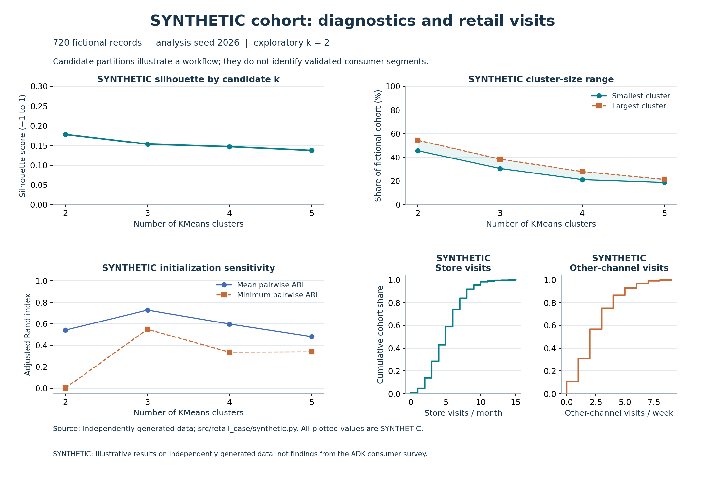
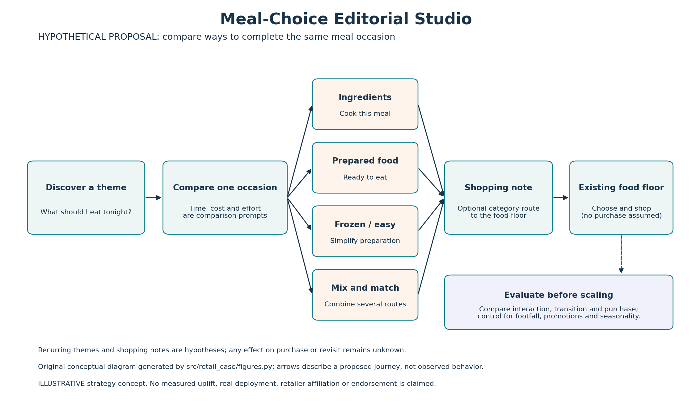

# 今日の食えらび編集室 / Meal-Choice Editorial Studio

A reproducible Python case study exploring the path from **customer behavior analysis** to **retail experience design**. It combines data validation, exploratory PCA/KMeans segmentation, visualization, and strategy evaluation in one end-to-end workflow.

**「食の比較編集ハブ」 (Meal-Choice Editorial Hub)** is a retail experience concept built around a simple question: *What should I eat today?* Shoppers compare cooking from ingredients, prepared dishes, frozen/easy meals, and combinations for the same occasion. A shopping note connects these choices to the food floor, while rotating meal themes give visitors something new to explore.

## Eight stages, one evidence chain

| Stage | Notebook | What it establishes |
| --- | --- | --- |
| 01 · Understand | [Data understanding](notebooks/01_data_understanding.ipynb) | Data schema, quality checks, missingness, and modeling assumptions |
| 02 · Diagnose | [Retail visits](notebooks/02_retail_diagnosis.ipynb) | Store and cross-channel visit patterns |
| 03 · Explore | [Opportunity](notebooks/03_opportunity.ipynb) | Opportunities for customer engagement and evaluation questions |
| 04 · Segment | [Segmentation](notebooks/04_segmentation.ipynb) | Standardization, PCA, candidate k, balance, and sensitivity |
| 05 · Interpret | [Targeting](notebooks/05_targeting.ipynb) | Customer profiles, targeting considerations, and a no-segmentation baseline |
| 06 · Compare | [Competitor / 3C](notebooks/06_competitor_3c.ipynb) | Retail channel comparison using the 3C framework |
| 07 · Position | [Positioning](notebooks/07_positioning.ipynb) | Points of parity/difference and a proposed value proposition |
| 08 · Test | [Strategy / pilot](notebooks/08_strategy_pilot.ipynb) | Customer journey, operating risks, KPIs, and pilot design |

Stages 01–05 use reusable Python components; stages 06–08 connect the analysis framework to positioning, experience design, and a practical evaluation plan.

## Reproduce

Requires Python **3.11–3.13**; the reference environment uses **Python 3.12**. From the repository root:

```bash
python -m venv .venv
. .venv/bin/activate
python -m pip install -e '.[dev]' -c requirements-dev.lock

retail-case generate --output build/synthetic.csv --n 720 --seed 2026
retail-case analyze --input build/synthetic.csv --output-dir build/report --seed 2026
retail-case visuals --output-dir build/visuals

pytest
ruff check .
ruff format --check .
python scripts/check_notebooks.py
```

After installation, data generation, analysis, tests, and notebook execution can run offline. Analysis writes `report.json`, `report.md`, `diagnostics.csv`, `profiles.csv`, `sensitivity.csv`, `baseline.csv`, and diagnostic/journey figures under `build/report/`. Generated CSVs and reports belong in ignored `build/`.

`requirements-dev.lock` records the reference environment's pinned dependency snapshot, with conditional transitive pins for Python 3.11 compatibility. CI covers Python 3.11–3.13; local reference results use 3.12. The two included preview figures can be regenerated from the synthetic example and the meal-choice concept. Existing outputs are protected: to intentionally regenerate them, use `retail-case visuals --output-dir assets --overwrite`. Each visual is available as PNG and SVG. See [synthetic data](docs/SYNTHETIC_DATA.md) for the schema and assumptions.

## Method and interpretation



The analysis uses **synthetically generated data** to make every step reproducible. The generator combines overlapping continuous factors and noise without predefined customer groups. Seven simulated attitude features enter the clustering pipeline; visit counts and identifiers are excluded. The workflow handles missing values, standardizes features, applies a variance-based PCA rule, and compares KMeans partitions using silhouette, cluster balance, adjusted Rand index (ARI), and sensitivity checks.

### Reproducible example

With **720 synthetic observations (seed 2026)**, PCA retains **6 components**, explaining **91.75%** of standardized variance. Silhouette scores are **0.178, 0.154, 0.147, and 0.137** for k=2–5, indicating limited separation in this example.

The k=2 partition has a mean pairwise initialization ARI of **0.541** (minimum **0.0003**), while removing the time-pressure feature yields an ARI of **0.553** against the reference. These results illustrate sensitivity to initialization and feature selection. The project also evaluates a **no-segmentation baseline**.

For detailed assumptions, diagnostics, and interpretation guidance, see [Analytical limitations](docs/ANALYTICAL_LIMITATIONS.md) and [Synthetic data](docs/SYNTHETIC_DATA.md).

## From a proposal to a pilot



The experience is designed around shoppers choosing meals under time pressure while considering different preparation options. [The strategy case](docs/STRATEGY_CASE.md) develops the customer journey, 3C/POP/POD positioning, 4P decisions, operational risks, KPI definitions, and a pilot evaluation plan covering seasonality, promotions, stockouts, footfall, and attribution.

## Project details

This portfolio implementation includes an independent Python package, a synthetic data generator, eight executable notebooks, and original visualizations. See [Project charter](docs/PROJECT_CHARTER.md) and [Provenance and scope](docs/PROVENANCE_AND_SCOPE.md) for design assumptions, data sources, and project boundaries.

**License:** [MIT](LICENSE) · **CI:** Python 3.11–3.13 via GitHub Actions.
